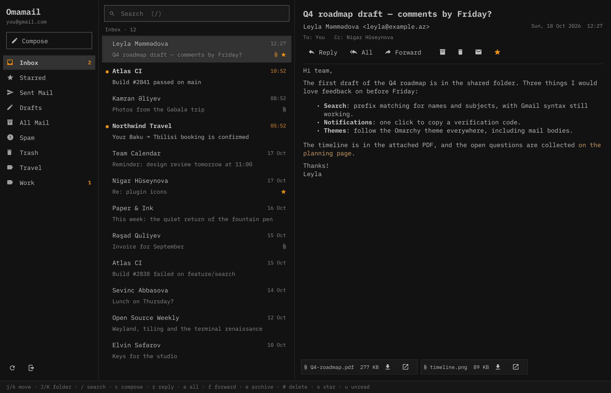

<p align="center">
  <picture>
    <source media="(prefers-color-scheme: dark)" srcset="share/logo-white.svg">
    
  </picture>
</p>

# Omamail

A light Gmail client that lives inside the [Omarchy](https://omarchy.org) shell.



<sub>Shown with sample mail.</sub>

- **UI**: a QML panel plugin for `omarchy-shell`. It uses the shell's own
  components and theme tokens, so it follows the current Omarchy theme,
  font and rounding. Nothing runs while the window is closed: the shell
  unloads the plugin, which ends the backend.
- **Backend**: a ~3 MB Rust binary (`omamail`), about 7 MB of RAM. IMAP for
  reading, SMTP for sending, all over TLS.
- **Notifications**: `omamail watch` runs as a user service, sits in IMAP
  IDLE on the inbox and posts a desktop notification per new message.
  Clicking it opens the message.
- **Verification codes**: when a new mail carries a one-time code ("295092 is
  your code", "Doğrulama kodunuz: 123 456"), the notification shows the code
  and clicking it copies the code to the clipboard instead. Codes are read
  from the subject, or from the body when the subject reads like a
  verification mail. The copy is marked sensitive, so it stays out of the
  clipboard history; the code does show in Omarchy's notification history.

## Install

Omamail is an Omarchy shell plugin. Add it like any other plugin, then
build its backend once:

```bash
omarchy plugin add https://github.com/reav4nn/omamail.git --enable
~/.config/omarchy/plugins/reavann.omamail/install.sh
```

`omarchy plugin add` only clones the repo; `install.sh` builds the Rust
backend into `~/.local/lib/omamail/` and installs the launcher entry, the icon and the
`omamail-watch` notification service. It needs Rust
(`omarchy install dev-env rust`); attaching files needs `zenity`
(`omarchy pkg add zenity`). See [Requirements and permissions](#requirements-and-permissions).

Open it from the app launcher ("Omamail"), or bind a key in
`~/.config/hypr/bindings.lua` to:

```bash
omarchy-shell shell toggle reavann.omamail '{}'
```

To update (the update shows a diff first; look over changes to `backend/`
and `install.sh` before accepting, since `install.sh` builds that code):

```bash
omarchy plugin update reavann.omamail
~/.config/omarchy/plugins/reavann.omamail/install.sh
omarchy restart shell
```

To remove:

```bash
systemctl --user disable --now omamail-watch.service
omarchy plugin remove reavann.omamail
rm -rf ~/.local/lib/omamail ~/.config/omamail ~/.cache/omamail ~/.local/state/omamail
rm ~/.config/systemd/user/omamail-watch.service ~/.local/share/applications/omamail.desktop \
   ~/.local/share/icons/hicolor/scalable/apps/omamail.svg
secret-tool clear application omamail
```

### Signing in

Omamail uses a Gmail **app password**: turn on 2-Step Verification, then
create one at <https://myaccount.google.com/apppasswords>. The password is
stored in the desktop keyring (`secret-tool`), never in a file; the address
and server names live in `~/.config/omamail/config.json`.

## Requirements and permissions

What Omamail needs, and everything it touches outside the plugin folder:

- **Build**: Rust (`cargo`). `install.sh` builds `backend/` with `--locked`;
  build output goes to `~/.cache/omamail/target`.
- **Runtime**: `secret-tool` with a running keyring (gnome-keyring),
  `notify-send`, `wl-copy` and `xdg-open`, which Omarchy ships, and `zenity` for the
  attachment picker, which it does not: `omarchy pkg add zenity`.
- **Network**: `imap.gmail.com:993` and `smtp.gmail.com:465` over TLS. Remote
  images are fetched only after you press *Load images*, and only from public
  addresses; like in any mail client, the sender's server then sees your IP,
  and `http://` images travel unencrypted.
- **Files**: the backend binary in `~/.local/lib/omamail/`; account settings
  in `~/.config/omamail/`; image cache in `~/.cache/omamail/`; watcher state in
  `~/.local/state/omamail/`; saved attachments in `$XDG_DOWNLOAD_DIR` or
  `~/Downloads`. A launcher entry and icon go to `~/.local/share/`, the unit
  file to `~/.config/systemd/user/omamail-watch.service`.
- **Services**: one systemd user unit, `omamail-watch.service`, which keeps an
  IMAP IDLE connection open for new-mail notifications. No root and no sudo;
  besides enabling the plugin, nothing in your existing configuration changes.
- **Secrets**: the Gmail app password lives only in the keyring; it never
  goes to argv, a file or a log.
- **Signing out** removes the password from the keyring and the account
  settings; cached images and the watcher state stay until you remove them
  (see *To remove* above).

## Keys

| Key | Action |
|---|---|
| `j` / `k`, arrows | next / previous message (opens it) |
| `J` / `K` | next / previous folder |
| `Enter` | open the selected message |
| `Space` / `Shift+Space` | scroll the message |
| `/` | search (Gmail syntax works: `from:x has:attachment`) |
| `c` | compose |
| `r` / `a` / `f` | reply / reply all / forward |
| `e` | archive |
| `#`, `Delete` | move to Trash |
| `s` | star |
| `u` | toggle read |
| `i` | load remote images |
| `R` | refresh |
| `Esc` | clear search, then close |
| `Ctrl+Enter` | send (composer) |

## Privacy and safety

- Mail HTML is sanitized (ammonia) down to the small subset Qt renders:
  no scripts, forms, iframes, inline styles or event handlers. Links open
  only for `http(s)` and `mailto`; the target shows in the status bar on hover.
- Remote images are blocked until you press **Load images**, so opening a
  mail does not ping trackers. When loaded, they are fetched by the backend
  from public addresses only (no LAN, localhost or Tailscale targets),
  at most 40 images of 5 MB each.
- Attachments are saved to `~/Downloads` under a sanitized file name and
  never overwrite an existing file. "Save and open" only opens common
  document, image and media types, checked by extension *and* by content
  (a JAR named `invoice.pdf` is saved, not run).
- All other mail text (subjects, names) is shown as plain text, never markup.

## Development

```
manifest.json, Panel.qml, Backend.qml, Format.js, components/
           the QML panel plugin (Panel.qml is the entry point)
backend/   Rust: IMAP/SMTP, MIME, sanitizer, JSON-lines server, watcher
share/     launcher entry, icon, logo and user service unit
```

Working from a checkout elsewhere, `./install.sh` builds the backend and
copies the plugin files (without `.git`) into
`~/.config/omarchy/plugins/reavann.omamail`; run it again after each change.
It never links the checkout there: `omarchy plugin update` would treat a
linked checkout as its own and may reset it.

```bash
cd backend && cargo test     # unit tests
./install.sh                 # rebuild + reinstall
omarchy restart shell        # pick up QML changes
```

The shell caches compiled QML, so QML edits need a shell restart to show up.

The backend speaks one JSON object per line on stdio
(`{"id":1,"cmd":"list","folder":"INBOX","before_uid":0}`); see `backend/src/server.rs`.
