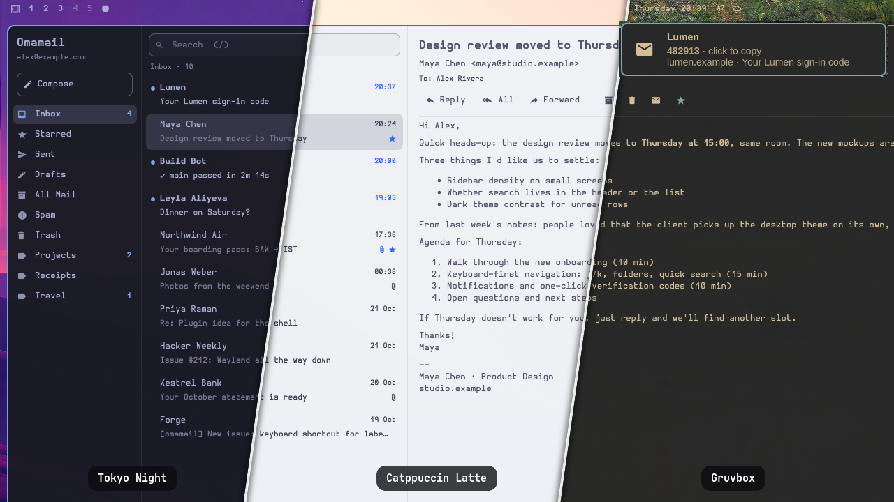

<p align="center">
  <picture>
    <source media="(prefers-color-scheme: dark)" srcset="share/logo-white.svg">
    
  </picture>
</p>

# Omamail

Gmail in the [Omarchy](https://omarchy.org) shell: a keyboard-driven mail
panel that follows your theme, with desktop notifications and one-click
verification codes.



<sub>Sample mail.</sub>

## Features

- **Part of the shell.** Built from `omarchy-shell`'s own components and theme
  tokens, so colours, font and rounding change with the theme.
- **Notifications.** A user service waits on the inbox with IMAP IDLE and
  posts one notification per new message; clicking it opens the message.
  After a suspend or a Wi-Fi or VPN change it reconnects within seconds.
  Gmail itself usually announces new mail over IMAP 10–50 seconds after it
  arrives, for any client.
- **Verification codes.** When a new mail carries a one-time code, the
  notification shows it and a click copies it. The copy is marked
  sensitive and stays out of clipboard history.
- **Keyboard first.** Move with `j`/`k`, search with `/` (Gmail syntax),
  compose with `c`. See [Keys](#keys).
- **Light.** A ~3 MB Rust backend using about 7 MB of RAM. Closing the
  window ends it; only the notification service keeps running.
- **Careful with mail.** HTML is sanitized, remote images load only when
  you ask, and attachments never overwrite a file or run as a program.

## Install

Needs Rust (`omarchy install dev-env rust`). Attaching files also needs
zenity (`omarchy pkg add zenity`).

```bash
omarchy plugin add https://github.com/hajizadaravan/omamail.git --enable
~/.config/omarchy/plugins/reavann.omamail/install.sh
```

`omarchy plugin add` clones the plugin; `install.sh` builds the backend into
`~/.local/lib/omamail/` and installs the launcher entry, the icon and the
notification service.

Open Omamail from the app launcher, or bind a key in
`~/.config/hypr/bindings.lua` to:

```bash
omarchy-shell shell toggle reavann.omamail '{}'
```

### Sign in

Omamail signs in with a Gmail **app password**. Turn on 2-Step
Verification, then create one at <https://myaccount.google.com/apppasswords>.
The password is kept in the desktop keyring, never in a file.

## Keys

| Key | Action |
|---|---|
| `j` / `k`, arrows | next / previous message (opens it) |
| `J` / `K` | next / previous folder |
| `Enter` | open the selected message |
| `Space` / `Shift+Space` | scroll the message |
| `/` | search (Gmail syntax: `from:x has:attachment`) |
| `c` | compose |
| `r` / `a` / `f` | reply / reply all / forward |
| `e` | archive |
| `#`, `Delete` | move to Trash |
| `s` | star |
| `u` | toggle read |
| `i` | load remote images |
| `R` | refresh |
| `Esc` | clear search, then close |
| `Ctrl+Enter` | send (composer) |

## Update

Once a day a user timer checks for new commits and posts a notification
listing them. Click it, or run:

```bash
~/.config/omarchy/plugins/reavann.omamail/update.sh
```

This runs `omarchy plugin update`, which shows the diff before anything is
installed. Read changes to `backend/` and `install.sh` before accepting:
`install.sh` builds that code. Only then does it rebuild and restart the
shell. The daily check fetches into `~/.cache/omamail/update.git` and never
touches the plugin folder. To turn it off for good:

```bash
systemctl --user disable --now omamail-update-check.timer
```

## Remove

```bash
systemctl --user disable --now omamail-watch.service omamail-update-check.timer
omarchy plugin remove reavann.omamail
rm -rf ~/.local/lib/omamail ~/.config/omamail ~/.cache/omamail ~/.local/state/omamail
rm ~/.config/systemd/user/omamail-watch.service ~/.config/systemd/user/omamail-update-check.{service,timer} \
   ~/.local/share/applications/omamail.desktop \
   ~/.local/share/icons/hicolor/scalable/apps/omamail.svg
secret-tool clear application omamail
```

## Privacy and permissions

No root, no sudo, and nothing in your existing configuration changes besides
enabling the plugin.

| | |
|---|---|
| **Network** | `imap.gmail.com:993` and `smtp.gmail.com:465`, TLS only. A daily `git fetch` of this repository for the update check. |
| **Secrets** | The app password lives only in the keyring (`secret-tool`): never in argv, a file or a log. Notifications go straight to D-Bus and codes are piped to `wl-copy`, so senders, subjects and codes never appear in process arguments. |
| **Files** | Backend in `~/.local/lib/omamail/`, account settings in `~/.config/omamail/`, image, build and update caches in `~/.cache/omamail/`, service state in `~/.local/state/omamail/`, attachments in `$XDG_DOWNLOAD_DIR` (or `~/Downloads`). |
| **Desktop** | Launcher entry and icon in `~/.local/share/`; `omamail-watch.service`, `omamail-update-check.service` and `.timer` in `~/.config/systemd/user/`. |

How mail is handled:

- **HTML** is sanitized (ammonia) to the subset Qt renders: no scripts,
  forms, iframes, inline styles or event handlers. Subjects and names are
  always plain text.
- **Links** open only for `http(s)` and `mailto`; the target shows in the
  status bar on hover.
- **Remote images** stay blocked until you press *Load images*, so opening a
  mail does not ping trackers. They are then fetched from public addresses
  only (no LAN, localhost or Tailscale), at most 40 images of 5 MB each. As
  in any mail client, the sender's server sees your IP, and `http://`
  images travel unencrypted.
- **Attachments** are saved under a sanitized name and never overwrite a
  file. *Save and open* opens only common document, image and media types,
  checked by extension and by content: a JAR named `invoice.pdf` is saved,
  not run.
- **Verification codes** stay out of clipboard history, but do appear in
  Omarchy's notification history.
- **Signing out** removes the password, the account settings and the
  service state. Cached images stay until you remove them.

## Development

```
Panel.qml, Backend.qml, Format.js, components/   QML panel (Panel.qml is the entry point)
backend/                                         Rust: IMAP/SMTP, MIME, sanitizer, JSON-lines server, watcher
share/                                           launcher entry, icon, logo, systemd units
install.sh, update.sh                            build and install; update
tools/make-preview.sh                            regenerate preview.png
```

From a checkout elsewhere, `./install.sh` builds the backend and copies the
plugin into `~/.config/omarchy/plugins/reavann.omamail`. Run it after each
change, and restart the shell for QML changes (it caches compiled QML):

```bash
cd backend && cargo test --locked && cd ..
./install.sh
omarchy restart shell
```

The backend speaks one JSON object per line on stdio, for example
`{"id":1,"cmd":"list","folder":"INBOX","before_uid":0}`; see
`backend/src/server.rs`. Contributions: [CONTRIBUTING.md](CONTRIBUTING.md).

## License

[MIT](LICENSE)
